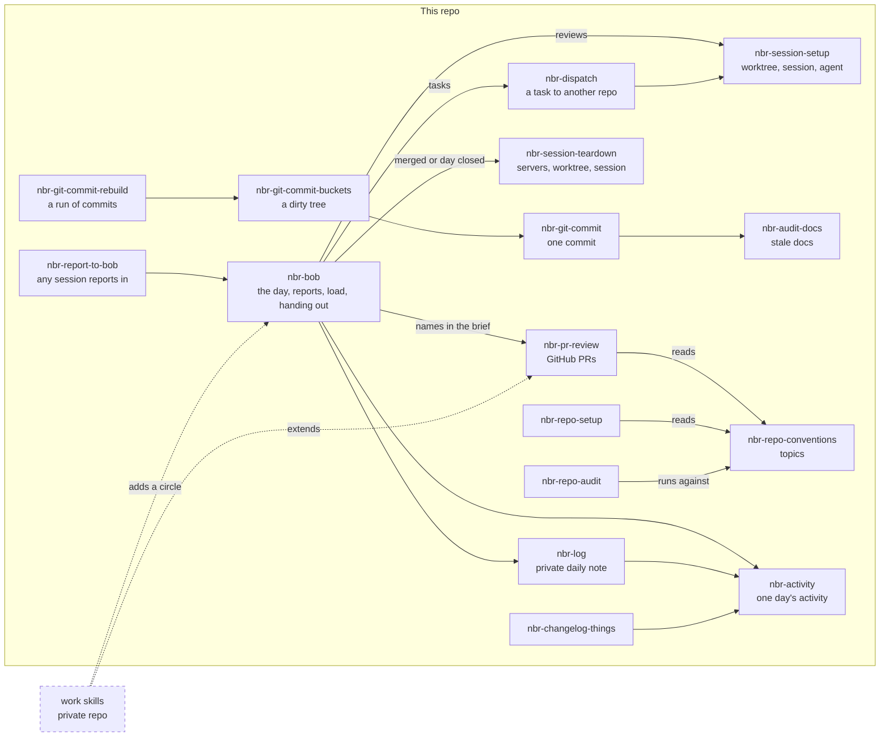
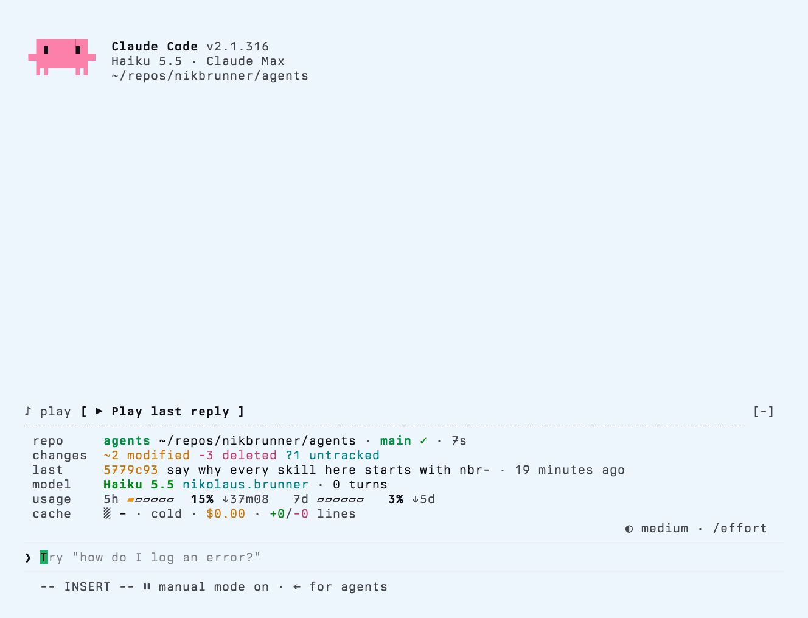

# agents

My agent setup: skills for Claude Code, Pi, Codex and anything else that reads `SKILL.md`, Claude Code mods, and the config of the agents I run. The skills encode how I plan, commit, open PRs and set up repos, so they are opinionated by design. Take what fits.

> [!TIP]
> Want to use parts of this with your own agent? Paste it [these instructions](#instructions-for-agents).

## Contents

- [Instructions for agents](#instructions-for-agents)
- [What is here](#what-is-here)
- [Install the skills](#install-the-skills)
- [Working copy](#working-copy)
  - [Third-party skills](#third-party-skills)
- [Skills](#skills)
  - [How they work together](#how-they-work-together)
  - [Engineering](#engineering)
  - [Personal](#personal)
- [Mods](#mods)
  - [dash](#dash)
  - [play](#play)
  - [Installing mods](#installing-mods)
  - [Third-party mods](#third-party-mods)
- [Claude Code settings](#claude-code-settings)
  - [Status line](#status-line)
- [License](#license)

## Instructions for agents

To have your coding agent set up parts of this repo for you, paste this into it:

```text
Read https://github.com/nikbrunner/agents, starting with its README, and help me adopt parts of it into my own setup. It is Nik's personal setup, so I take pieces of it, and my own config stays mine.

1. Ask which pieces I want, and read what I already have: my settings.json, skills and plugins.
2. Show the changes you plan, including anything of mine that would change, and wait for my yes.
3. Make the changes, then check that each piece works.

For each piece:

- Skills: use the commands under "Install the skills", and first install what each skill's compatibility field requires.
- Mods: use the commands under "Installing mods".
- Settings: merge the keys I choose into my settings.json and keep my existing values unless I say otherwise. Read home/.claude/settings.json only for reference, since its paths and pass:// secret references work only on Nik's machines.
- Status line: follow "Status line". It needs a clone, so ask me where to put it, and replace ~/repos/nikbrunner/agents with that path.
- Instructions: treat home/.agents/AGENTS.md as a source of ideas. It describes Nik, so adapt what I like into my own file.

Everything else installs without a clone. Clone only for the status line, or if I want to edit the skills or mods.

install.sh, symlinks.yml and scripts/ are for Nik's machines, and they replace global config with links into this repo. Use them only if I explicitly want the whole setup, after showing me what scripts/symlinks.sh --dry-run would change. scripts/migrate-to-agents.sh is a one-time move for his machines and never applies to anyone else.
```

## What is here

| Folder                     | Holds                                                                                |
| -------------------------- | ------------------------------------------------------------------------------------ |
| [`skills`](skills)         | My `nbr-*` skills                                                                    |
| [`mods`](mods)             | Claude Code mods, published as the `nbr` plugin marketplace                          |
| [`plugins`](plugins)       | Claude Code plugins for my own setup, in the same `nbr` marketplace                  |
| [`statusline`](statusline) | A Claude Code status line for subagents and the hooks that feed it                   |
| [`home`](home)             | Agent config that mirrors `~`: global `AGENTS.md`, subagents, Claude Code, Pi, Codex |

## Install the skills

> [!NOTE]
> Every skill here starts with `nbr-`. That prefix is a namespace: my skills sit together in the `/` menu, you can find them by typing `/nbr`, and names like `/commit` stay free for yours. I wish more third-party skills did this.

The skills sit in two folders. [`engineering`](skills/engineering) covers coding work and the tools it runs on. [`personal`](skills/personal) covers life outside the code. [Skills](#skills) lists what each one needs installed first.

All of them:

```sh
npx skills add nikbrunner/agents
```

One folder:

```sh
npx skills add https://github.com/nikbrunner/agents/tree/main/skills/engineering
```

One skill:

```sh
npx skills add nikbrunner/agents --skill nbr-git-commit
```

`npx skills add nikbrunner/agents --list` shows everything with its description.

## Working copy

My machines run from a clone. `install.sh` links everything into place:

```sh
git clone https://github.com/nikbrunner/agents ~/repos/nikbrunner/agents
~/repos/nikbrunner/agents/install.sh
```

What it does:

- Links the config in `home/` into `~`, as listed in [`symlinks.yml`](symlinks.yml). An existing file is moved aside as `<name>.backup.<timestamp>`; [`scripts/symlinks.sh`](scripts/symlinks.sh) does the linking and runs on its own too, and its `--dry-run` shows what would change. It is a copy of the linker in my dots repo, whose `dots link` runs this one after its own.
- Links every skill folder in `skills/<group>/` into `~/.agents/skills`, removing links whose skill no longer exists and never replacing a real file or directory.
- Points `~/.claude/skills` and `~/.claude-work/skills` at `~/.agents/skills`.

Run it again after adding or removing a skill or a `symlinks.yml` entry.

### Third-party skills

The third-party skills I use, including the ones these skills depend on, are recorded in `skills-lock.json`. `install.sh` restores them into `.agents/skills/` (gitignored) and links them next to mine. Manage them from the repo root, then commit the lock:

```sh
npx skills add <source> --skill <name> -a codex   # -a codex installs into .agents/skills
npx skills update -p
npx skills remove <name>
```

## Skills

Each skill names its own requirements in the `compatibility` field of its `SKILL.md`.

### How they work together

Arrows are references written in the skill files. Solid boxes are skills in this repo. The dashed box is my work skills, which live in a private repo and build on these.



#### A day with Bob

`nbr-bob` runs Bob, my digital assistant, which has access to my notes. It opens and closes the day in every circle's daily note, the private one in my Obsidian vault and one per work circle that a work skill adds. Other sessions send it their state with `nbr-report-to-bob`, and it files each report in the right note. It hands PR reviews out to sessions it sets up with `nbr-session-setup` and tasks through `nbr-dispatch`, watches how much runs at once, and at day close offers to tear down sessions whose work merged, which it does only on my yes.

#### A PR review

Bob asks me whether a PR goes to review. On yes, it has `nbr-session-setup` build a worktree on the PR's branch with an install that runs no scripts, a Rex session with the Agents, Edit and Shells tabs, and a Claude agent whose brief names the circle's review skill. There `nbr-pr-review` judges the PR's shape, reads every changed file against `nbr-repo-conventions`, and leaves its report in the pane, with fixes and a comment draft on offer. The agent stays for follow-ups, and when I'm done it offers `nbr-session-teardown` on its own session. A work skill wraps `nbr-pr-review` for another host, replacing the steps that differ.

#### A dispatch

`nbr-dispatch` confirms the target repo with me, checks its state, writes the brief with the worker's boundary rules, and launches it through `nbr-session-setup`. The worker sends its handoff to the dispatching session when it finishes. A worker Bob dispatched also reports to Bob with `nbr-report-to-bob`, since Bob's brief asks for it, so the day's note gets the outcome.

#### The day's record

`nbr-activity` collects one day's commits and GitHub activity. `nbr-log` writes the private daily note from it, and `nbr-changelog-things` logs it as Things items.

#### Commits

`nbr-git-commit` makes one commit: review, gate, commit, with `nbr-audit-docs` as the docs check. `nbr-git-commit-buckets` sorts a dirty tree into several commits through it, and `nbr-git-commit-rebuild` turns a run of commits back into a dirty tree for buckets.

#### Repo conventions

`nbr-repo-conventions` holds the topics. `nbr-repo-setup` sets a repo up from them and `nbr-repo-audit` checks a repo against them without changing it.

### Engineering

How I plan, commit, open PRs, set up repos and run coding agents.

| Skill                    | What it does                                                                        |
| ------------------------ | ----------------------------------------------------------------------------------- |
| `nbr-plan`               | Grill an idea to shared understanding, then write a plan for a PO and a developer   |
| `nbr-afk-implementation` | Finish approved implementation work autonomously while you are away                 |
| `nbr-git-commit`         | Commit with selective staging, a review pass and an approval gate                   |
| `nbr-git-commit-buckets` | Sort a dirty working tree into atomic commits                                       |
| `nbr-git-commit-rebuild` | Rewrite a run of commits into clean atomic ones                                     |
| `nbr-create-pr`          | Draft and publish a pull request                                                    |
| `nbr-audit-docs`         | Find documentation a diff made stale                                                |
| `nbr-how-to-test`        | Write a black-box acceptance testing checklist                                      |
| `nbr-repo-conventions`   | Conventions for personal projects, by topic                                         |
| `nbr-repo-setup`         | Set up repo tooling from those conventions                                          |
| `nbr-repo-audit`         | Audit a repo against those conventions without changing it                          |
| `nbr-glossary`           | Extract a DDD-style glossary from the conversation                                  |
| `nbr-handoff`            | Compact the conversation into a handoff document                                    |
| `nbr-self-reflection`    | Turn a correction into a durable improvement                                        |
| `nbr-slow-mode`          | Slow down for learning and human decisions                                          |
| `nbr-record-clip`        | Record motion as a dark and light looping WebP, or a video with `cap`               |
| `nbr-dispatch`           | Start a coding agent for another repo in a Rex session                              |
| `nbr-session-setup`      | Set up a worktree, a Rex session, and optionally an agent                           |
| `nbr-session-teardown`   | Tear a session down without losing unpushed or open work                            |
| `nbr-pr-review`          | Review a GitHub PR or a branch against the repo conventions                         |
| `nbr-intercom`           | Talk directly to an agent session running in another repo                           |
| `nbr-nvim-dev`           | Neovim and Lua development workflow                                                 |
| `nbr-bkt`                | Bitbucket in my setup: token auth, Data Center limits, PR screenshots, landing a PR |

Install these first:

| Dependency                                                          | Install                                                              | Used by                                                    |
| ------------------------------------------------------------------- | -------------------------------------------------------------------- | ---------------------------------------------------------- |
| [`humanizer`](https://github.com/blader/humanizer)                  | `npx skills add blader/humanizer`                                    | `nbr-plan`, `nbr-create-pr`                                |
| [`documentation-writer`](https://github.com/github/awesome-copilot) | `npx skills add github/awesome-copilot --skill documentation-writer` | `nbr-git-commit`, and through it `-buckets` and `-rebuild` |
| [Plannotator](https://github.com/backnotprop/plannotator)           | see its README, it ships `plannotator-annotate`                      | `nbr-plan`                                                 |
| `gh` or [`bkt`](https://github.com/avivsinai/bitbucket-cli)         | your package manager                                                 | `nbr-create-pr`                                            |

`nbr-record-clip` needs ImageMagick, plus VHS, ffmpeg, Playwright or [Cap](https://cap.so) depending on what it records. `nbr-dispatch`, `nbr-session-setup` and `nbr-session-teardown` need [Rex](https://www.superlogical.com/rex). `nbr-pr-review` needs `gh`, `nbr-intercom` needs Claude Code, `nbr-nvim-dev` needs Neovim and ripgrep, and `nbr-bkt` needs `bkt` and `pass-cli`.

### Personal

Bob and the daily notes, tasks in Things 3, and speech from ElevenLabs.

| Skill                  | What it does                                                  | Requires                                                                                                        |
| ---------------------- | ------------------------------------------------------------- | --------------------------------------------------------------------------------------------------------------- |
| `nbr-bob`              | Run Bob, my digital assistant, through the day across circles | Rex, `gh`, `nbr-activity`, `nbr-log`, `nbr-session-setup`                                                       |
| `nbr-report-to-bob`    | Send this session's state to Bob                              | Claude Code; Rex across accounts                                                                                |
| `nbr-activity`         | Collect one day's commits and GitHub activity                 | macOS, git, jq, `gh`                                                                                            |
| `nbr-log`              | Write the day's development work into the private note        | `nbr-activity`, an Obsidian vault                                                                               |
| `nbr-things`           | Manage Things 3 tasks on macOS                                | Things 3, the `things` CLI                                                                                      |
| `nbr-changelog-things` | Log a day's development work as completed Things items        | Things 3, the `things` CLI, `nbr-activity`                                                                      |
| `nbr-tts`              | Turn text into speech with ElevenLabs                         | ElevenLabs account, the `elevenlabs` CLI, jq, ffmpeg, `npx skills add elevenlabs/skills --skill text-to-speech` |
| `nbr-apple-music`      | Curate, clean up and organize Apple Music                     | macOS, Music.app, the `apple-music` MCP                                                                         |
| `nbr-images`           | Generate and edit images with FLUX                            | The `FLUX` MCP, `cwebp`                                                                                         |

## Mods

[`mods`](mods) holds my Claude Code mods, one plugin per folder.

### dash

<picture>
  <source media="(prefers-color-scheme: dark)" srcset="docs/assets/readme/dash-dark.webp">
  
</picture>

A session dashboard above the prompt: workspace, git, agent, tasks, limits, cost and what the conversation is working on. `/dash` hides and shows it. [Its README](mods/dash/README.md) has the settings and the cost.

The dash shows a red badge next to the account when `DASH_BADGE` is set, with its value as the text. I set `DASH_BADGE=WORK` in the shell function that starts Claude Code with my work account.

### play

`/play` reads the last reply aloud through ElevenLabs. It needs an ElevenLabs API key, `mpv` and `nc`; [its README](mods/play/README.md) has the setup.

### Installing mods

The repo is a plugin marketplace named `nbr`. Add it once, then install the mods you want:

```sh
claude plugin marketplace add nikbrunner/agents
claude plugin install dash@nbr
claude plugin install play@nbr   # optional: needs an ElevenLabs key, mpv and nc
```

To update, refresh the marketplace and then each mod:

```sh
claude plugin marketplace update nbr
claude plugin update dash@nbr
```

Restart Claude Code after installing or updating. Mods need a recent Claude Code, and I run them on 2.1.316. `/plugin` lists what loaded.

To edit a mod and use it live, load it from a clone instead, as a colon-separated list in the `env` block of `~/.claude/settings.json`:

```json
"CLAUDE_CODE_PLUGIN_DIRS": "~/repos/nikbrunner/agents/mods/dash:~/repos/nikbrunner/agents/mods/play",
"CLAUDE_CODE_PLUGIN_DIR_WATCH": "1"
```

### Third-party mods

I also run [`cache-tax`](https://github.com/karanb192/cache-tax), which keeps the prompt cache warm during breaks and shows the estimated cost before a cold send:

```sh
claude plugin marketplace add karanb192/claude-code-mods
claude plugin install cache-tax@claude-code-mods
```

## Claude Code settings

My full settings are in [`home/.claude/settings.json`](home/.claude/settings.json). The main ones:

```json
{
  "model": "opus[1m]",
  "editorMode": "vim",
  "tui": "fullscreen",
  "voice": { "enabled": true, "mode": "hold" },
  "promptCacheTtl": "1h",
  "includeCoAuthoredBy": false,
  "env": {
    "CLAUDE_CODE_SUBAGENT_MODEL": "haiku",
    "ENABLE_TOOL_SEARCH": "true",
    "CLAUDE_CODE_ENABLE_TODO_TOOLS": "1"
  }
}
```

- `model`: Opus with the 1M-token context window.
- `editorMode`: Vim keys in the prompt.
- `tui`: the fullscreen interface.
- `voice`: dictation while a key is held.
- `promptCacheTtl`: keeps the prompt cache for an hour instead of five minutes, so a session picked up after a short break still reads from the cache.
- `includeCoAuthoredBy`: no Claude co-author line in commits.
- `CLAUDE_CODE_SUBAGENT_MODEL`: subagents run on Haiku.
- `ENABLE_TOOL_SEARCH`: MCP tools load when a task needs them instead of filling the context up front.
- `CLAUDE_CODE_ENABLE_TODO_TOOLS`: turns the task list tools back on for newer models, so Helm can show how far a session has got.

### Status line

<picture>
  <source media="(prefers-color-scheme: dark)" srcset="docs/assets/readme/dash-dark.webp">
  
</picture>

I've turned my status line off almost completely, because what it showed now lives in the dash. All that's left is Claude Code's own footer, with the Vim mode and the permission mode, and a tracker for running subagents.

Turning it off takes no setting of its own. `settings.json` has no `statusLine` block, and without one Claude Code shows only its footer. To do the same, delete the block.

The subagent tracker is in [`statusline`](statusline): each running subagent gets a progress bar built from the `PROGRESS: n/m · step` lines it writes. Two hooks make subagents write them: `subagent-start.sh` asks for the lines when a subagent starts, and `post-tool-batch.sh` reminds it after 20 tool calls without one. They need `bash` and `jq`.

Clone the repo, then point the settings at the scripts in the clone:

```sh
git clone https://github.com/nikbrunner/agents ~/repos/nikbrunner/agents
```

```json
{
  "subagentStatusLine": {
    "type": "command",
    "command": "~/repos/nikbrunner/agents/statusline/claude-subagent-statusline"
  },
  "hooks": {
    "SubagentStart": [
      {
        "hooks": [
          {
            "type": "command",
            "command": "~/repos/nikbrunner/agents/statusline/subagent-start.sh",
            "timeout": 5
          }
        ]
      }
    ],
    "PostToolBatch": [
      {
        "hooks": [
          {
            "type": "command",
            "command": "~/repos/nikbrunner/agents/statusline/post-tool-batch.sh",
            "timeout": 5
          }
        ]
      }
    ]
  }
}
```

With a `hooks` block already in the file, add the two events to it.

## License

MIT
